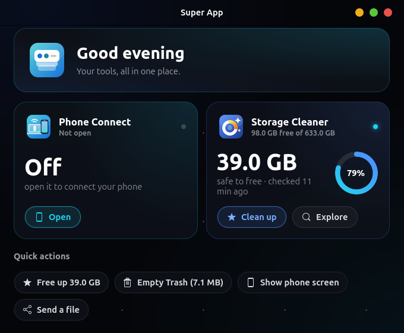

# Super App

All your desktop tools in one place. Super App is a small GTK4 + libadwaita hub: each **plugin** adds a live card
(a number, a meter, buttons) and quick actions. Plugins can be full apps of their own or just a card.



| Plugin | What it does | Runs on |
|---|---|---|
| [Phone Connect](plugins/phone-connect) | Mirror and control an Android phone/tablet over Wi-Fi, phone as webcam/mic/speaker, tablet as a second screen | Linux (GNOME) |
| [Storage Cleaner](plugins/storage-cleaner) | See what fills your disk and free space safely | Linux |
| [Disk Space](plugins/disk-space) | Free space on your main drive. A minimal example plugin | Linux, Windows, macOS |

## Install

**Ubuntu / Debian** - download `super-app_<version>_all.deb` from [Releases](../../releases), then:

```bash
sudo apt install ./super-app_*_all.deb
```

**Windows** - download and run `Super-App-Setup-<version>.exe` from [Releases](../../releases).
GTK is bundled; nothing else to install.

**From source (Linux)**:

```bash
sudo apt install python3-gi gir1.2-gtk-4.0 gir1.2-adw-1
git clone https://github.com/fairuzald/super-app && cd super-app
./packaging/linux/install.sh          # adds "Super App" to the app menu, runs from this folder
# or just run it:  ./bin/super-app
```

## Plugins

Menu › **Plugins** lists every plugin, lets you switch them on/off, and opens the folder for add-ons
(`~/.local/share/super-app/plugins` on Linux, `%LOCALAPPDATA%\super-app\plugins` on Windows). A plugin is a folder
with a `plugin.toml` and a Python class - see **[Writing a plugin](docs/writing-plugins.md)**.

Plugins declare the platforms they support; on other systems they're listed as unavailable instead of crashing.

## Repository layout (monorepo)

```
packages/core     superapp_core - plugin API, manifest, loader, registry, ports. Pure Python, no GUI. Tested on 3 OSes.
packages/hub      superapp_hub  - the GTK4 window: renders any plugin's status, Plugins dialog.
plugins/*         bundled plugins (plugin.toml + plugin.py, and app/ when the plugin is its own app)
packaging/linux   install.sh (per-user, from checkout) and build-deb.sh
packaging/windows PyInstaller spec, MSYS2 build script, Inno Setup installer
bin/super-app     run from a checkout without installing
docs/             architecture and plugin guide
```

See **[Architecture](docs/architecture.md)** for how the pieces fit and how SOLID shows up in the code.

## Develop

```bash
uv sync                                  # or: pip install pytest ruff
uv run pytest                            # core + bundled-plugin tests
uv run ruff check .
/usr/bin/python3 bin/super-app --check   # load all plugins headless (used by CI and installers)
```

CI runs the core tests on Linux, Windows and macOS, builds and installs the `.deb`, and builds the Windows
installer. Pushing a `v*` tag publishes both to a GitHub Release.
