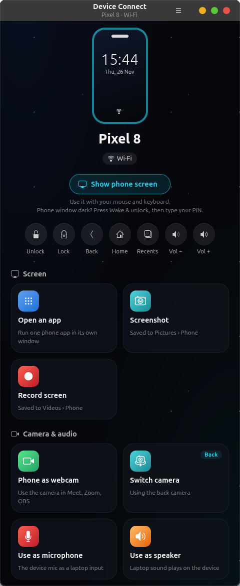
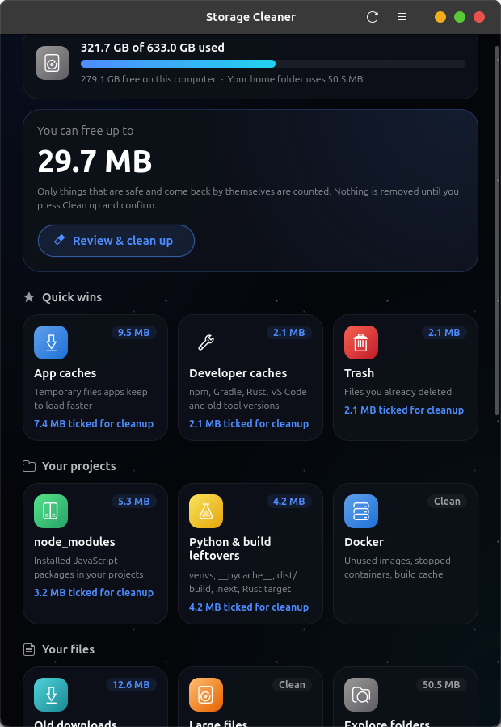
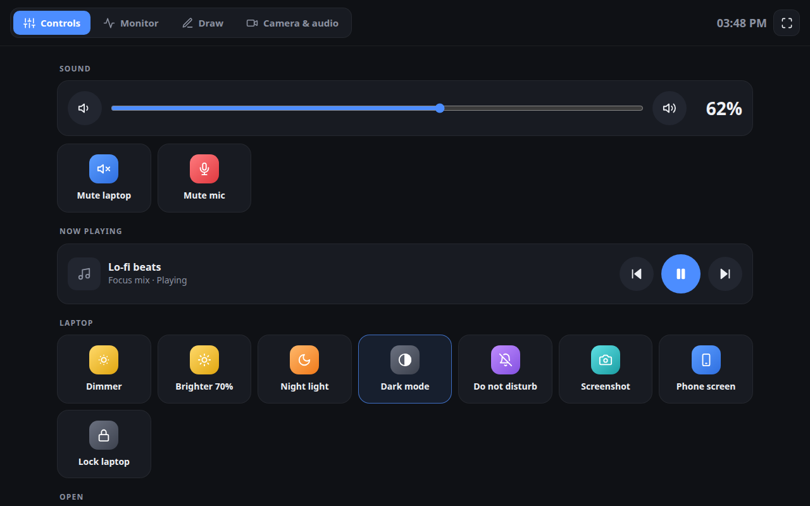
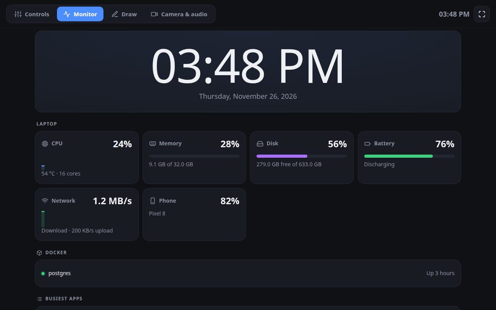
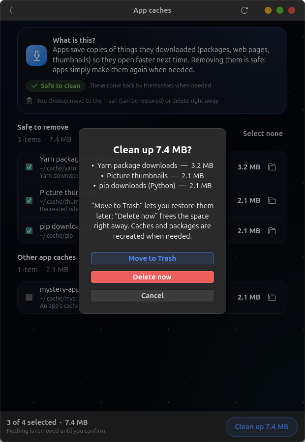
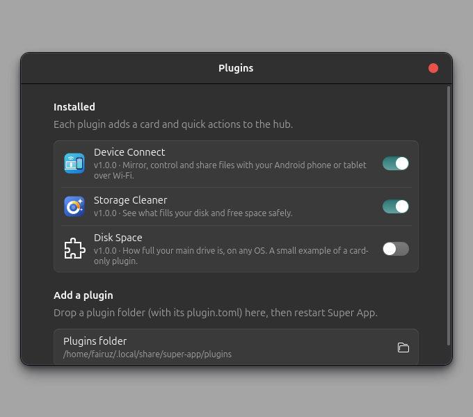

# Super App

All your desktop tools in one place, on **Linux, Windows and macOS**. Super App is a small GTK4 + libadwaita hub:
each **plugin** adds a live card (a number, a meter, buttons) and quick actions. A plugin can be a full app of its
own or just a card.

<p align="center"></p>

## Plugins

| Plugin | What it does | Linux | Windows | macOS |
|---|---|:-:|:-:|:-:|
| [Device Connect](plugins/device-connect) | Use your Android phone or tablet from the computer over Wi-Fi: mirror and control it, screenshots, screen recording, files both ways, a tablet control panel and live monitor | ✓ | ✓ | ✓ |
| ↳ Linux extras | Phone as webcam, microphone or speaker; tablet as an extra monitor or drawing pad; notifications and SMS | ✓ | – | – |
| [Storage Cleaner](plugins/storage-cleaner) | See what fills your disk and free space safely: caches, developer junk, node_modules, old downloads, large files, Docker, Trash / Recycle Bin | ✓ | ✓ | ✓ |
| ↳ System cleanup | apt cache, old snaps, system logs | ✓ | – | – |
| [Disk Space](plugins/disk-space) | Free space on your main drive. A minimal example plugin | ✓ | ✓ | ✓ |

Features a system can't do are hidden there, not shown broken.

## Screenshots

<table>
  <tr>
    <td width="50%"><br><b>Device Connect</b>: mirror, control and share files with your phone</td>
    <td width="50%"><br><b>Storage Cleaner</b>: what you can free, by category</td>
  </tr>
  <tr>
    <td><br><b>Tablet control panel</b>: volume, media, laptop toggles, launcher</td>
    <td><br><b>Tablet live monitor</b>: CPU, memory, disk, battery, Docker</td>
  </tr>
  <tr>
    <td><br>Nothing is removed until you confirm. Trash or delete, your choice</td>
    <td><br><b>Plugins</b>: switch add-ons on/off, or add your own</td>
  </tr>
</table>

## Install

Download from **[Releases](../../releases/latest)**.

| System | File | How |
|---|---|---|
| **Windows 10/11** | `Super-App-Setup-<version>.exe` | Run it. GTK is bundled. |
| **macOS 12+** | `Super-App-<version>.dmg` | Open it, drag **Super App** to Applications. First start: right-click › Open (the app isn't notarized). |
| **Ubuntu / Debian** | `super-app_<version>_all.deb` | `sudo apt install ./super-app_*_all.deb` |

Device Connect also needs [scrcpy](https://github.com/Genymobile/scrcpy). It offers to install it for you:
`apt` on Linux, `winget` on Windows, `brew` on macOS.

**From source (Linux):**

```bash
sudo apt install python3-gi gir1.2-gtk-4.0 gir1.2-adw-1
git clone https://github.com/fairuzald/super-app && cd super-app
./packaging/linux/install.sh          # adds "Super App" to the app menu, runs from this folder
```

## Add-ons

Menu › **Plugins** lists every plugin, switches them on and off, and opens the add-ons folder:

- Linux: `~/.local/share/super-app/plugins`
- Windows: `%LOCALAPPDATA%\super-app\plugins`
- macOS: `~/Library/Application Support/super-app/plugins`

A plugin is a folder with a `plugin.toml` and a Python class. See **[Writing a plugin](docs/writing-plugins.md)**.

## Repository layout (monorepo)

```
packages/core        superapp_core - plugin API, manifest, loader, registry, ports. Pure Python, no GUI.
packages/hub         superapp_hub  - the GTK4 window: renders any plugin's status, Plugins dialog.
plugins/*            bundled plugins: plugin.toml + plugin.py, and app/ when the plugin is its own app
packaging/linux      install.sh (per user, from a checkout) and build-deb.sh
packaging/windows    MSYS2 build script and Inno Setup installer
packaging/macos      Homebrew build script (.app + .dmg)
packaging/pyinstaller  the shared PyInstaller spec for Windows and macOS
bin/super-app        run from a checkout without installing
docs/                architecture, plugin guide, screenshots
```

See **[Architecture](docs/architecture.md)** for how the pieces fit and how SOLID shows up in the code, and
**[Security](SECURITY.md)** for the security model.

## Develop

```bash
uv sync && uv run pytest && uv run ruff check .           # core + bundled-plugin contract tests
/usr/bin/python3 -m pytest plugins/*/tests/test_*.py      # plugin tests (need PyGObject)
/usr/bin/python3 bin/super-app --check                    # load all plugins without a window
```

On every push, CI:
- runs the tests on Linux, Windows and macOS;
- builds and installs the `.deb`;
- builds the Windows installer and the macOS disk image.

Pushing a `v*` tag publishes all three to a GitHub Release.
